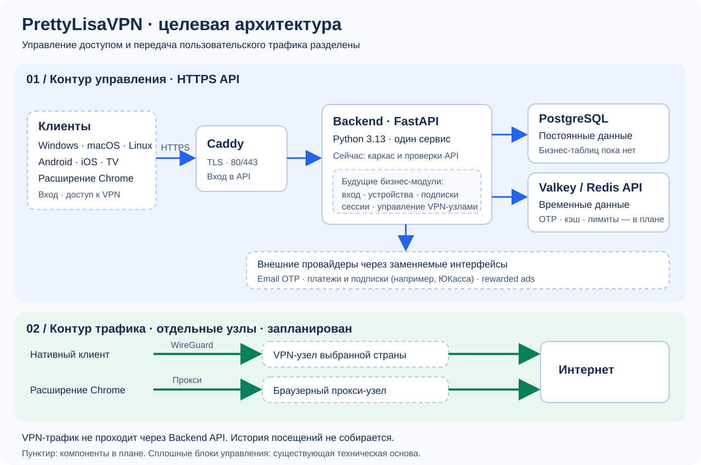

> Current implementation (Android 0.11.0, Windows 0.14.0, backend 0.16.0):
> real VPN connections and engines have been removed. Connect runs 14 placeholders,
> each failing after three seconds. See [reset handoff](docs/vpn-placeholder-reset.md).

<p align="center">
  
</p>

# PrettyLisaVPN

PrettyLisaVPN — проект коммерческого VPN-сервиса для Windows, macOS, Linux, Android, iOS, Android TV и Chrome. В репозитории находятся backend, Windows-клиент, остальные клиентские проекты, инфраструктура и инструкции для разработчиков и администраторов.

**Текущее состояние на 2026-10-19: backend 0.10.0, Windows 0.11.1, schema 0026.** Реализованы email OTP/session API, устройства, права подписки, VPN control plane, сообщения аккаунту, поддержка и устойчивые платёжные операции с тестовым адаптером. Windows подключён к этим API; development backend развёрнут за HTTPS.

**Реальный платёжный провайдер отключён.** OTP-вход Windows поставлен владельцем на паузу; доставка поддержки в inbox и полный Windows VPN data plane ещё не приняты. Реализацию, фактические проверки и backlog различает [текущий статус проекта](docs/project-status.md).

## Основные сценарии и их границы

1. **Вход без пароля.** Пользователь вводит email и подтверждает его одноразовым кодом из письма — OTP. Постоянный пароль создавать и запоминать не нужно.
2. **Регистрация устройства.** Приложение связывает устройство с аккаунтом. На аккаунте может быть не более пяти активных устройств; сервер обеспечивает этот лимит.
3. **Выбор подключения.** FREE и Premium позволяют выбрать AUTO или страну, а сервис всегда внутренне подбирает конкретный VPN-узел. FREE использует только отмеченные для бесплатного плана узлы.
4. **Проверка доступа.** Backend проверяет тариф, устройство и возможность начать сессию, затем предоставляет данные для подключения. Управление аккаунтом происходит через HTTPS API.
5. **Передача трафика.** Нативный клиент устанавливает туннель WireGuard с отдельным VPN-узлом. Посещения сайтов и другой пользовательский трафик идут через этот узел, минуя Backend API.
6. **Бесплатный доступ.** Free без рекламы: до одного часа в сутки UTC на весь аккаунт. Одна сессия может использовать оставшийся час и заканчивается не позднее полуночи UTC. Неиспользованное время возвращается после подтверждения удаления peer. Premium и ручной Platinum без рекламы и суточного ограничения в пределах оплаченного периода. [Таблица прав и правила срока](docs/subscription-entitlements.md).
7. **Оплата Premium.** Покупки и регулярные списания обрабатывает внешний платёжный провайдер, например ЮКасса. Backend учитывает подтверждённое состояние подписки через заменяемый provider port; реквизиты банковских карт сервис у себя не хранит. Сейчас доступен только явно включаемый development/test sandbox; реальный провайдер не подключён.

Для расширения Chrome предусмотрена работа только с браузером через прокси. Оно не поднимает системный WireGuard-туннель и не защищает трафик остальных приложений. Раздельная маршрутизация по спискам включения и исключения запланирована на будущее и сейчас не реализована.

## Архитектура верхнего уровня



На схеме показана **целевая архитектура**. Control plane, бизнес-модули API, Node Agent и Windows native tunnel layer реализованы. Статус настройки конкретных внешних интеграций и приёмки трафика следует проверять отдельно; схема не подтверждает production-готовность всех платформ.

Архитектура разделяет две задачи:

- **Контур управления (control plane)** отвечает за вход, устройства, подписки и разрешение на подключение. Клиенты обращаются к Backend по HTTPS. Caddy принимает публичное соединение, обслуживает TLS-сертификат и передаёт API-запрос внутрь Docker-сети.
- **Контур передачи трафика (data plane)** обслуживает соединения пользователя с интернетом. Это отдельные WireGuard-узлы для нативных приложений и прокси-узлы для Chrome. Backend не находится на пути VPN-трафика.

| Компонент | Ответственность и причина выбора |
| --- | --- |
| Backend: Python 3.13, FastAPI | Модульный монолит: один развёртываемый сервис с разделением логики по предметным областям. Это упрощает старт и эксплуатацию; микросервисы для MVP не нужны. |
| HTTP-контроллеры | Проверяют входные данные и вызывают прикладные сервисы. Правила тарифов и сессий должны находиться в прикладном/доменном слое, а не в обработчиках HTTP. |
| PostgreSQL и SQLAlchemy 2.x | Источник истины для аккаунтов, устройств, auth/VPN-сессий, подписок, billing operations/receipts, сообщений и поддержки. Alembic реализован; текущий head — 0026. |
| Valkey, совместимый с Redis | Временные OTP, cooldown и rate limits. Долговечные auth-сессии и бизнес-данные хранятся в PostgreSQL. |
| Pydantic v2 | Проверка API-схем и конфигурации приложения. Ошибки API должны иметь стабильные машинные коды. |
| Внешние провайдеры | Timeweb SMTP для email; заменяемый BillingProvider и сохранённый sandbox для платежных проверок. LIVE отсутствует, Free работает без рекламы. |
| Docker, Terraform, Ansible | Docker/Compose используются для запуска и development deployment; Ansible содержит playbooks WireGuard-узлов, Node Agent и transport profiles. Terraform пока заготовка. Kubernetes для MVP не предусмотрен. |

Продуктовая и маркетинговая аналитика должна помогать понимать использование функций и привлечение пользователей, не собирая историю посещений. Нельзя записывать в журналы адреса посещаемых ресурсов, DNS-запросы, URL и содержимое пакетов. OTP в production и приватные ключи WireGuard также не должны попадать в логи.

## Структура репозитория

```text
apps/
  windows/           Windows-клиент: Tauri 2, React, Rust, API/native adapters
  desktop/           Заготовка остальных desktop-клиентов
  android/           Kotlin/Compose Android 0.5.0: account API, Keystore, operation recovery и native CI
  ios/               Заготовка клиента iOS
  android-tv/        Заготовка клиента Android TV
  chrome-extension/  Заготовка браузерного прокси-клиента
backend/             API, настройки, подключения к хранилищам и тесты
infra/
  deployment/        VPS: Backend + Caddy, HTTPS и скрипт развёртывания
  docker/            Локальный стек и отдельный production-запуск Backend
  terraform/         Заготовка описания облачных ресурсов
  ansible/           Playbooks WireGuard-узлов, Node Agent и transport profiles
  monitoring/        Заготовка мониторинга
  environments/      Заготовка конфигурации окружений
docs/                Инструкции настройки и эксплуатации, схемы
```

## Быстрый запуск на своём компьютере

Нужны Git и работающий Docker с Compose v2. На Windows Docker должен использовать Linux-контейнеры. Откройте терминал **в корне репозитория**, где находится этот README.

1. Соберите Backend и запустите его вместе с PostgreSQL и Valkey:

   ```sh
   docker compose -f infra/docker/compose.yaml up --build -d --wait
   ```

   `-f` выбирает конфигурацию, `--build` собирает образ из исходников, `-d` оставляет контейнеры работать в фоне, а `--wait` ожидает запуска. Первый запуск займёт больше времени из-за скачивания образов.

2. Посмотрите состояние контейнеров:

   ```sh
   docker compose -f infra/docker/compose.yaml ps
   ```

   Откройте [готовность API](http://127.0.0.1:8000/ready) и [версию API](http://127.0.0.1:8000/version) в браузере. `/ready` должен вернуть HTTP 200, если доступны обе базы. `/health` проверяет только работающий процесс, поэтому одного его недостаточно.

3. Посмотрите сообщения Backend:

   ```sh
   docker compose -f infra/docker/compose.yaml logs -f backend
   ```

   `Ctrl+C` завершает просмотр логов; контейнер продолжает работать.

4. После работы остановите локальный стек:

   ```sh
   docker compose -f infra/docker/compose.yaml down
   ```

   Данные PostgreSQL сохранятся в Docker-томе. Не добавляйте `-v`, если хотите их сохранить. Пароль в локальном Compose — публичный учебный пример, для VPS он не подходит.

## Подробные инструкции

| Задача | Документ |
| --- | --- |
| Актуальные функции, незавершённая приёмка и backlog | [Текущий статус](docs/project-status.md) |
| Android: архитектура Kotlin/Compose, API/экраны/дизайн/native и план переноса | [Архитектура](docs/android-architecture.md), [план](docs/android-porting-plan.md) |
| Запуск через Docker или Python, настройки, тесты | [Разработка Backend](backend/README.md) |
| Подготовка VPS, домена, HTTPS и первый production-запуск | [Развёртывание Backend](docs/backend-deployment.md) |
| Обновление кода на VPS, пересборка/загрузка образа, перезапуск и откат | [Обновление и перезапуск VPS](docs/vps-maintenance.md) |
| Базовая защита выделенного VPN-узла DigitalOcean без WireGuard | [Базовая защита VPN-узла](docs/digitalocean-vpn-node-baseline.md) |
| Создание тестового окружения в Timeweb Cloud | [Настройка Timeweb](docs/timeweb-development-setup.md) |
| Версии клиента и backend, порядок изменений и выпуска | [Версионирование](docs/versioning.md), [история изменений](CHANGELOG.md) |
| Экраны Windows, popup и переходы между ними | [Карта навигации Windows](docs/windows-navigation.md) |
| Обязательные правила работы с репозиторием | [AGENTS.md](AGENTS.md) |

Документацию, пояснения к настройке и описания дальнейших изменений ведём на русском языке. В инструкциях указываем, где выполнять команды, зачем нужен каждый шаг и как проверить результат. Технические идентификаторы, команды и названия переменных сохраняем в исходном виде.

## Windows-клиент

Текущий клиент, требования к native runtime и команды запуска: [apps/windows/README.md](apps/windows/README.md).

## Android-клиент

[Android 0.5.0](apps/android/README.md): OTP/session, profile/devices/messages,
subscription overview и support API, защищённое восстановление операций.
[Контракты/ограничения](docs/android-account-api.md). Платежи DISABLED/SANDBOX недоступны;
настоящий provider и VPN runtime не подключены. Автотесты работают без реальных писем/списаний.
[Fixture screens](docs/android-fixture-screens.md) изолированы в instrumentation.
[Дизайн](docs/android-design.md), [архитектура](docs/android-architecture.md),
[будущая локализация](docs/android-localization.md). Точные SHA/артефакты/результаты — в PR.
