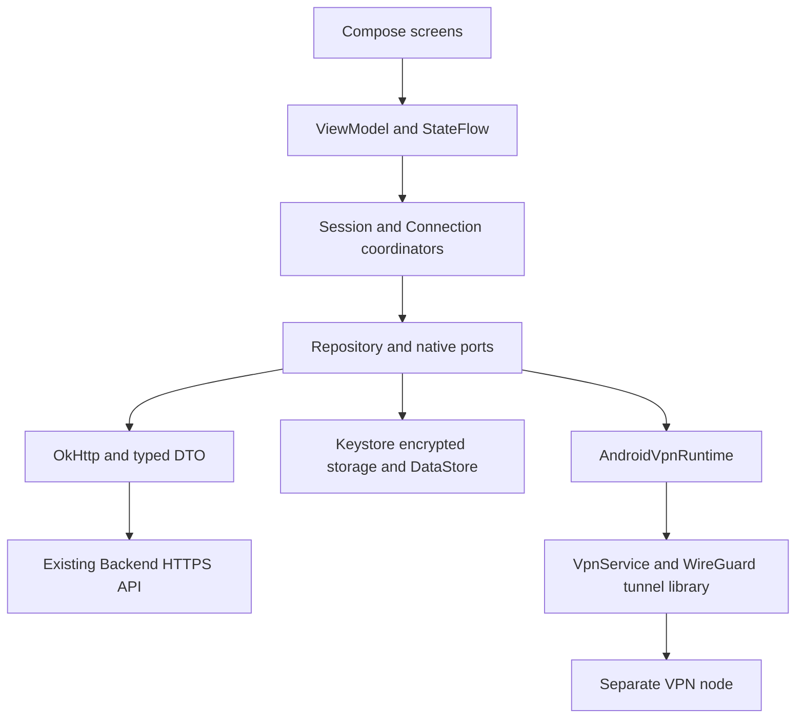

# Android: архитектура Kotlin и Jetpack Compose

Статус: **архитектурное решение и план переноса**. Начальный каркас Android
**0.1.0** реализован в `apps/android`: Gradle, Compose, три вкладки и CI.
[Сборка, текущие ограничения и проверка на эмуляторах](../apps/android/README.md).
Остальные разделы описывают целевую архитектуру; API/VPN ещё не реализованы.
Аудит 2026-10-19, `develop` **69ab8d1d3d3c5680fc72bb23980776242606a104**:
Windows **0.11.1**, backend **0.10.0**, schema **0026**. В `apps/android` до этой
задачи был только `.gitkeep`. Backend, Windows и инфраструктура не изменяются.
Версии независимы: Android начинает с 0.1.0; Windows/backend unchanged. [Этапы переноса](android-porting-plan.md).

## 1. Решение и границы повторного использования

Отдельное приложение **Kotlin + Jetpack Compose + Material 3 с собственной темой**,
одна Activity, Navigation Compose, ViewModel, Coroutines/StateFlow. Windows служит
эталоном оформления и сценариев; React, CSS, Tauri и Win32-код не исполняются на Android.
Переносится поведение контрактов, а не бинарный Windows runtime.

| Переносим | Заменяем Android-реализацией | Пока исключаем |
| --- | --- | --- |
| Логотип/знак, Rubik с лицензией, палитру, тексты, карточки и состояния | React/router → Compose/NavHost; Credential Manager → Keystore-backed storage; HTTP → OkHttp; WireGuardNT → Android tunnel runtime | Desktop titlebar, drag/minimize/close, фиксированный canvas 960×640 |
| DTO, коды ошибок, идемпотентность, серверные права и семантику VPN state machine | ShellExecuteW → проверенные Custom Tabs/Intent; Web File → Photo Picker/SAF; focus/online → lifecycle/connectivity callbacks | Прямой доступ к БД, Node Agent и его mTLS-секретам; новые backend API |
| JSON fixtures и сценарии тестов, правила first candidate/no fallback | Windows routes/LUID verification → Android VPN network/route verification | Реальные платежи, новые протоколы, split tunneling, always-on/lockdown и автоподключение после boot как готовые функции |

Исходники-эталоны: [composition root](../apps/windows/src/main.tsx),
[навигация](../apps/windows/src/ui/App.tsx), [карта Windows](windows-navigation.md),
[API](../apps/windows/src/api/client.ts), [VPN manager](../apps/windows/src/vpn/connection.ts).
Выносить общий multiplatform-код или переписывать Windows ради переноса не требуется.

## 2. Слои и владение состоянием



Предлагаемая структура внутри одного app-модуля, без преждевременного множества
Gradle-модулей:

```text
app/.../prettylisavpn/
  app/                 Application, DI composition, Activity, navigation
  core/design/         PrettyLisaTheme, tokens, reusable Compose components
  core/network/        DTO/serialization, API clients, stable error mapping
  core/storage/        credential vault, installation ID, preferences
  domain/              SessionCoordinator, ConnectionCoordinator, policies/ports
  data/                auth/devices/messages/billing/support repositories
  vpn/                 runtime adapter, verification, service integration
  feature/             auth, home, settings, devices, subscription, about, support
```

- ViewModel не управляет TUN, ключами и серверными peers. Compose не запускает
  VPN из recomposition. `StateFlow` содержит безопасное UI-состояние, без токенов,
  приватных ключей и полного native bootstrap.
- `SessionCoordinator` сериализует refresh и переходы аккаунта; generation/epoch
  не дают старому ответу обновить новый аккаунт или воскресить logout.
- `ConnectionCoordinator` владеет desired state, session UUID, reconciliation,
  deadline и cleanup; протокол скрыт за `VpnProtocol`/`VpnSessionProvisioner`.
- `AndroidVpnRuntime` владеет tunnel lifecycle; экраны только наблюдают его.
  Активное соединение не зависит от Activity/ViewModel и не останавливается при
  повороте экрана. WorkManager не держит активный туннель: пригоден лишь для
  отложенной ограниченной сверки/очистки с доступными credentials.
- Репозитории и native ports подменяются тестовыми адаптерами. Они не могут
  включаться в release через обычную пользовательскую настройку.

Предлагаемые зависимости: Compose BOM/Material 3, AndroidX Activity/Navigation/
Lifecycle, Coroutines, OkHttp, kotlinx.serialization, DataStore; WireGuard tunnel
library за отдельным портом. DI сначала через composition root/конструкторы.
БД Room не нужна до появления подтверждённой потребности: ограниченные receipt ID
и pending intents допускают атомарное локальное хранилище.
Предлагаемый applicationId — `com.prettylisavpn.android`, development — с отдельным
suffix `.dev`; namespace и signing identity подтвердить при bootstrap. Flavors
изолируют credentials/installation UUID и считаются разными установками для лимита устройств.

## 3. Карта экранов и мобильная навигация

После auth — три основные вкладки: **главная / настройки / о приложении**.
На compact width нижняя навигация, на широкой области navigation rail; проверять
доступную ширину окна, не модель устройства. Auth имеет отдельный graph без
активной основной навигации. Email и OTP не помещаются в URI/deep link.

| Windows | Android destination / компонент | Контракт и мобильная адаптация |
| --- | --- | --- |
| SessionRestorationGate, до route | StartupGate | Loading/retry/offline/reauth; не показывать защищённый экран до решения о сессии |
| `/login`, Login | Auth.Email | Email, валидация, запрос OTP, loading/error; IME email, кнопка остаётся доступной при клавиатуре |
| `/auth/verify-otp`, OtpVerification | Auth.Otp | 6 цифр, paste, countdown resend, invalid/expired/rate limit; Back → email, проверка очистки кода; успешный вход очищает auth back stack |
| `/`, Home | Main.Home | Сводка аккаунта, тариф/устройства, страна, CONNECT/status, локация, режим трафика; карточки вертикально, не масштабировать две desktop-колонки |
| ConnectionLocationSelector | CountryPicker sheet | Autopilot, top-3 и полный список по Windows policy; качество из API, недоступные страны disabled; stale snapshot не выдавать за свежий |
| CurrentLocation | Home.PublicLocation | Loading/result/error/retry, без запроса GPS; отдельно от выбранной страны и статуса VPN |
| ConnectionInfo | ConnectionDetails sheet | Показать только фактические проверенные параметры активного runtime, неизвестные не выдумывать |
| TrafficMode | Home.TrafficMode card | «весь трафик» активен; оба выборочных режима disabled/«скоро», без Android-specific split tunneling в первом переносе |
| `/settings` | Main.Settings | Подписка, устройства, выход; обычные мобильные строки-карточки |
| `/settings/devices`, Devices | Settings.Devices | UUID/имя/даты/статус/current, список с прокруткой, подтверждение отзыва; nullable last_login_at не подменять refresh-временем |
| `/settings/subscription`, Subscription | Settings.Subscription | Тариф, срок, auto-renew, способ, offers/RUB/USD, pending receipt, refresh; исходно read-only |
| PaymentChoice, cancel confirmation | Subscription sheets/dialog | Четыре маршрута/валюты/recurring из capabilities; реальные mutation/redirect недоступны при DISABLED/SANDBOX |
| `/about`, About | Main.About | Версия Android и реальный GET /version, FAQ как в Windows (не создавать выдуманные ответы), поддержка |
| SupportDialog | About.Support screen | Полноэкранная форма удобнее маленького desktop popup; receipt/status в ней, Back учитывает pending/черновик; диагностика ограничена разделом 5 |
| AccountMessages поверх graph | AccountMessage dialog/sheet | После auth, account/revision ACK, очередь, ошибки; действия только OPEN_SUBSCRIPTION/OPEN_SETTINGS/OPEN_ABOUT |

Правила переходов:

- Back сначала закрывает sheet/dialog, затем вложенный экран, затем возвращает
  Home; уход с Home не означает DISCONNECT. Повторный tap вкладки не создаёт копии graph.
- Unknown route безопасно ведёт в разрешённый экран; не переносить известную
  пустую область неизвестного `/settings/*` из Windows. Deep links не обходят auth.
- Поворот сохраняет безопасные черновики/выбранную страну; email только в памяти
  auth flow, OTP/секреты не записывать в SavedStateHandle или сохранённое состояние.
- После отзыва устройства и возврата Home обновить `/me`; cached profile может
  отображаться до ответа, но данные предыдущего аккаунта немедленно удаляются.
- При logout сохраняем правдивый результат: сетевой сбой не считается успехом
  и не уничтожает refresh credential. Local VPN stop/backend cleanup согласовать
  до отзыва auth-сессии; при device_revoked локальный туннель закрывается сразу.

## 4. Дизайн-токены и мобильные размеры

Канон — [design-system.md](design-system.md). Значения сверены с текущим
[styles.css](../apps/windows/src/ui/styles.css); в CSS есть поздние overrides:
например, финальная ширина desktop sidebar 112px, а не первый блок 220px.
Android не переводит CSS px механически в dp и не наследует фиксированную высоту.

| Исходный токен | HEX | Семантика Compose |
| --- | --- | --- |
| Black | `#010101` | onSurface / основной текст |
| Mercury | `#e4e4e4` | surface / текст на брендовых поверхностях |
| Purple Heart | `#5f22d9` | primary / действия и фон |
| Christalle | `#2c016d` | navigation/background dark |
| Dusty Gray | `#9c9c9c` | muted / disabled; проверять контраст |
| Galliano | `#d7ad0d` | warning, без декоративного использования |
| Scorpion | `#5b5b5b` | secondary text на светлой карточке |
| Viking | `#51d6ca` | CTA, selected navigation, success accent |
| Heliotrope | `#ac73ff` | focus/outline/accent |
| Persian Red | `#c82b28` | error / destructive |

`PrettyLisaTheme` задаёт явные semantic colors/typography/shapes. Dynamic Color
не включать по умолчанию: системная палитра не должна заменять бренд. Начальная
тема повторяет фиолетовый фон, тёмную навигацию и светлые карточки Windows;
самостоятельная альтернативная dark theme — отдельная задача.

| Элемент | Источник Windows | Предлагаемый Android-токен / правило |
| --- | --- | --- |
| Шрифт | Rubik variable 300–900 | Локальный font resource, `sp`, поддержка fontScale; не скачать шрифт при запуске |
| Типографика | h1 поздний override 30px; card title 18px; body 13–14px; secondary 11–12px | Заголовки 28/22sp, body 16/14sp, secondary 12sp как исходная мобильная шкала; подтвердить скриншотами при fontScale 1.0/1.3/2.0 |
| Отступы | Main 24px, home gap 14px, card padding 18px | Сетка 4/8/12/16/24/32dp; экран 16dp, карточки 16–20dp, интервалы 12–16dp |
| Формы | Card radius 12px, settings 14px | Shapes 12/16dp; sheet 24dp; мобильный выбор, не утверждение равенства CSS |
| Поля и кнопки | Viking primary, error red, focus purple | Поля/CTA 56dp или больше по контенту, hit target ≥48dp; disabled различим, focus ≥2dp |
| OTP | 24px, tabular digits, letter-spacing | Одна доступная input-модель на 6 цифр, не шесть независимых недоступных полей |
| Surface | Purple/Mercury, Heliotrope glow, Viking selected tint | Явные gradient/tint tokens; декоративный glow не снижает контраст текста |
| Варианты | loading/error/disabled/selected/stale | Общие компоненты StateCard, FormField, PrimaryAction, CountryRow, DeviceCard, StatusBadge |

Ресурсы: [полный SVG](../apps/windows/src/assets/prettylisavpn-logo.svg),
[каноническая копия](assets/prettylisavpn-logo.svg),
[Rubik.ttf](../apps/windows/public/fonts/rubik/Rubik.ttf),
[Rubik OFL](../apps/windows/public/fonts/rubik/OFL.txt),
[лицензия флагов](../apps/windows/src/assets/country-flags-LICENSE.md).
Перенос SVG в VectorDrawable/Compose vector требует визуального сравнения,
а не самостоятельной перерисовки. На стартовом экране полный знак с названием,
launcher/notification icon — исходный замок, с adaptive/monochrome вариантами.
Название всегда **PrettyLisaVPN**; lower-case применяется к согласованным labels,
не ко всему пользовательскому тексту, email, country codes или сообщениям сервера.

Мобильная проверка: 320/360/412dp, landscape, tablet/resize, cutouts, edge-to-edge
status/navigation bars, IME insets, TalkBack, ≥48dp targets, контраст, крупный шрифт,
длинные email/цены/runtime-версии. Bottom bar и CTA не перекрывают формы.
Для обязательного текста ориентир ≥4.5:1, для крупного ≥3:1; Dusty Gray не применять
к обязательной информации на Mercury, если контраст недостаточен. Палитру не менять:
выбирать подходящую семантическую пару, например Scorpion на светлой карточке.

## 5. API-карта: существующий backend без изменений

Источник wire contract — backend router/schema, затем Windows adapter. Kotlin DTO
не копируют тип `platform: WINDOWS` из TS как серверное ограничение: auth/messages
уже принимают enum `ANDROID`; support diagnostics, напротив, действительно Windows-only.
Публичный `https://api.prettylisavpn.com` сейчас обслуживает **development**.
Build flavors отделяют test/development/production; последний не объявлять готовым
по наличию URL. Запрещены cleartext в release и отключение проверки TLS.

| API | Payload / результат | Android-поведение |
| --- | --- | --- |
| GET `/health`, `/ready`, `/version` | health/dependencies; application_name/version/environment | `/health` не доказывает VPN или готовность БД; About использует фактический `/version`, при ошибке «недоступна» |
| POST `/auth/request-otp` | `{email}` → accepted | Cooldown/rate limit; не повторять автоматически неоднозначную отправку |
| POST `/auth/verify-otp` | email, code, installation_id UUID, **platform=ANDROID**, device_name | Access/refresh/session_id + user/device/subscription; код только в памяти |
| POST `/auth/refresh` | session_id, refresh_token → новая пара | Single-flight, атомарная замена credential, без параллельных повторов старого refresh |
| POST `/auth/logout`, GET `/me` | Bearer → logged_out; профиль/effective plan/device count | Auth state — источник UI; /me может содержать дополнительные entitlement поля, неизвестные безопасные поля не ломают DTO |
| GET `/devices`, DELETE `/devices/{id}` | Только свои устройства; revoked receipt | Лимит 5, current-device state и nullable last_login_at; повторное обновление профиля |
| GET `/vpn/countries` | Autopilot + countries: quality 0..100, available | Выбор AUTO/COUNTRY, не узла; availability не доказывает совместимость Android runtime |
| POST `/vpn/sessions` | `{mode:AUTO,public_key}` либо COUNTRY + country_code; header `X-VPN-Candidates: 1` | Нет node_id/profile/port в запросе. Ответ: UUID, ACTIVE, country, expires_at/server_time, transport и ordered candidates |
| GET `/vpn/sessions/current` | Bearer + `X-VPN-Candidates: 1` → session/null | Reconcile после startup, смены сети/возврата и неоднозначного POST; не создавать вторую сессию |
| DELETE `/vpn/sessions/{id}` | Termination status EXPIRED/DISCONNECTED/FAILED | Локальный stop и backend peer cleanup — разные подтверждения; pending cleanup сохранять |
| GET `/messages` | platform=ANDROID, **Android app_version**, locale, schema_version=1 | JSON v1, bounded response, очередь; отсутствие/ошибка не блокируют вход |
| POST `/messages/{id}/acknowledgements` | `{revision}` → receipt | ACK привязан к аккаунту/ревизии; навигация после подтверждения, без произвольных URI |
| GET `/billing/overview` | mode, 4 routes, currencies/recurring, revision, offers, actions, pending ID | Отображать цены из API, minor units как Long, даты UTC; не зашивать 199/2.99 как бизнес-правило |
| POST `/billing/operations`, GET `/billing/operations/{id}` | request_id, expected_revision, action, route/offer/currency; PENDING/SUCCEEDED/FAILED/CANCELED | Будущая мутация только при LIVE + availability/actions + подходящей capability. DISABLED/SANDBOX read-only, pending GET разрешён. Не включать real provider |
| POST `/support/requests`, GET `/support/requests/{id}` | multipart: report JSON + screenshots; request_id/status | Доступно с **diagnostics=null**; сначала status lookup, только 404 разрешает повтор POST тем же UUID |

**Поддержка — подтверждённое ограничение:**
[Diagnostics.platform](../backend/src/prettylisavpn/support/domain.py) —
`Literal["WINDOWS"]`, `Report.diagnostics` допускает null. Android отправляет null,
не маркирует себя WINDOWS и не отправляет ANDROID в несовместимый объект. Техническое
приложение к обращению недоступно до отдельного расширения backend-контракта;
текст/вложения/status могут работать без этого. Лимиты: subject 120, description
4000, до 3 PNG/JPEG/WebP, ≤5 МиБ каждый и ≤10 МиБ вместе; проверять MIME, decode,
размер и доступ к URI, не только расширение. Доставка в inbox не проверена этим аудитом.

Источники: [auth schema](../backend/src/prettylisavpn/auth/router.py),
[VPN router](../backend/src/prettylisavpn/vpn_nodes/router.py),
[billing DTO](../apps/windows/src/billing/model.ts),
[messages](../apps/windows/src/messages/client.ts),
[support transport](../apps/windows/src/support/client.ts).

HTTP/retry policy:

- Один OkHttp stack, закрытый error mapping по `{error:{code}}`; не отображать
  сырые ответы/exception text. 401/403 auth обрабатывать отдельно от Free quota,
  409 — конфликт состояния/revision, 429 — cooldown/rate limit, 503 — unavailable.
  Логические clients разделены: BackendHttpClient добавляет Bearer только точному
  backend origin и запрещает redirects; PublicLocationClient не имеет auth/cookies;
  InternetVerifierClient привязан к VPN и не использует physical connection pool.
  При VPN/network transition обновлять anonymous geo connection/DNS state, чтобы
  не показывать egress старого keep-alive соединения.
- Базовый request deadline 15s как в Windows config; поддержка имеет собственный
  bounded upload deadline (Windows 30s), messages 5s, public location 8s.
  Не прерывать OTP раньше server SMTP bound до 10s. Ограничить body/файлы и отмену.
- GET допускает ограниченный retry/backoff; POST OTP/verify/refresh/VPN create
  не повторять вслепую после timeout. У VPN create нет client request_id:
  reconcile current; биллинг/support повторяют прежний UUID и неизменный payload.
  Один ответ session=null после timeout не доказывает, что первый POST не завершится
  позже: держать unknown create intent, сериализовать bounded reconciliation и
  не превращать его в автоматическую новую POST-попытку.
- После process death между серверной refresh rotation и локальной записью может
  потребоваться новый вход: текущий backend не обещает recovery старого token.
  Не изобретать для него новый endpoint и не считать reauth дефектом хранения.

## 6. VPN-профили: каталог, runtime и доступность

Сегодня Android не поддерживает ни одного профиля в исполняемой сборке — её нет.
Для первого VPN-этапа проектируется только **WireGuard IPv4 full tunnel**.
Матрица ниже не является результатом Android E2E и не меняет server capabilities.

| Профиль / режим | Реальное состояние Windows/backend | Android-план / gate |
| --- | --- | --- |
| `WIREGUARD_UDP`, UDP 1..65535, default 51820, NONE | WireGuardNT; explicit UDP/NONE выставляет direct=true | Первый кандидат на реализацию через официальную tunnel library/GoBackend; порт брать из validated bootstrap, не всегда 51820 |
| WireGuard `transport=NATIVE`, obfuscation=NATIVE | Legacy policy локально выбирает DIRECT/PRETTYLISA_V1/WG_OBFUSCATOR | Не синоним direct. Нет auto-переноса Windows env/секретов. Только явно согласованная и проверенная локальная legacy policy; иначе UNSUPPORTED_CONFIGURATION |
| `SIMPLE_PACKET_WRAPPER_V1:1` + WireGuard/UDP | Windows Rust relay и совпадающий node forwarder, max_datagram_size default 1400 | Изначально disabled. Требуется отдельный Android packet-relay adapter, protected outer socket, общий wire-vector/MTU tests и matching node; GoBackend сам режим не реализует |
| `PRETTYLISA_V1` | Native Windows legacy transport, AEAD/секрет из защищённого operational setup | Disabled до Android adapter, wire compatibility, безопасного provisioning секрета; не зашивать PSK в APK/BuildConfig |
| `WG_OBFUSCATOR` | Windows component/process integration, upstream v1.6, NONE/STUN; не доказательство текущего live listener | Disabled. Windows exe/process/Job Object не переносятся; Android packaging/ABI/lifecycle/secret provisioning и межплатформенная проверка отдельные |
| `OPENVPN_TLS_TCP`, TCP443, TLS1.3/AES-256-GCM | Есть factory/validated ExternalTunnelRuntime port; runtime не bundled; backend sessions пока WireGuard-specific | Disabled. Нужны Android runtime и серверный bootstrap/provisioning, отсутствующие в замороженном контракте; TCP443 не означает HTTPS camouflage |
| `TLS_TRANSPORT:1` + OpenVPN/TCP | Только при заявленной capability внешнего runtime; TLS control channel не равен отдельному carrier | Disabled вместе с OpenVPN; не писать собственные TLS records, не отключать cert validation |
| `MASQUE_QUIC`, UDP443, TLS1.3/QUIC CONNECT-IP | Descriptor/external port есть, рабочего bundled runtime и общего bootstrap нет | Disabled; QUIC library/пример CLI сами по себе не CONNECT-IP VPN |

Общие исходные ограничения: MTU **1280**, dns_mode **VPN**, routing_mode
**FULL_TUNNEL**, `supports_ipv6=false`, `resembles_ordinary_tls=false`.
Нет автоматического fallback, дополнительных портов TLS/QUIC, выбора узла в UI
и поддержки split routing. [Каталог](../apps/windows/src/vpn/profiles.ts),
[обфускация](../apps/windows/src/vpn/obfuscation.ts),
[профили](connection-profiles.md), [native legacy modes](../apps/windows/src-tauri/src/obfuscation_transport.rs).

Backend различает legacy node и deployment evidence:
[deployed_session_candidates](../backend/src/prettylisavpn/vpn_sessions/connection.py)
возвращает legacy NATIVE при отсутствии migrated metadata, explicit WireGuard UDP
при проверенном профиле либо **пустой список** при несовпавшем/невалидном evidence.
Нельзя считать NATIVE единственным возможным ответом или менять empty на legacy.
TLS/QUIC descriptors не создают соответствующий peer/bootstrap.

Правила provisioner/registry:

1. Новый клиент посылает candidates header при create/current.
2. Отсутствующий candidates — compatibility legacy WireGuard с проверкой local
   policy; explicit `[]` — ошибка. Сохранять порядок, пробовать только первый.
3. Registry сопоставляет первый config реальному адаптеру/версиям/портам, сверяет
   country и WireGuard endpoint.port с bootstrap. Не перескакивать к следующему
   кандидату или другому узлу при unsupported. Созданную сессию корректно завершить.
4. Поле node_id не добавлять в UI/запрос выбора; private key не отправлять в API.
5. Country availability не гарантирует Android compatibility до получения config;
   при заведомо неготовом runtime CONNECT недоступен, после несовместимого ответа
   показывается честная ошибка, а не фиктивный Connected.

## 7. Native-зависимости и Android lifecycle

| Windows boundary | Android замена | Существенная проверка |
| --- | --- | --- |
| Tauri invoke / WindowFrame / Win32 | Compose + Activity/lifecycle ports | Нет desktop chrome и Win32 DLL; service не привязан к recomposition |
| Windows Credential Manager, refresh CAS | Keystore AES-GCM + atomic encrypted record, Mutex/CAS | Keystore invalidation → reauth; не хранить token в plaintext DataStore/backup |
| Installation ID UUID | App-scoped UUID в private storage | Stable при обычном restart, не IMEI/MAC/Android ID; исключить восстановление идентичности на другом устройстве через backup |
| WireGuard key manager | Официальная key API; private bytes защищены Keystore-backed encryption | Не обещать hardware X25519: Keystore защищает wrapping key; runtime может требовать private material в памяти |
| WireGuardNT + administrator + Windows routes | Официальная WireGuard tunnel AAR/GoBackend + Android VpnService + JNI libs | Root и Windows DLL не нужны. Consent, один владелец TUN, foreground/background policy, revoke, native stop |
| Socket/LUID verification | VPN-bound probes, route/network checks и counters | Не protect() проверочные запросы; обычный интернет через physical Network не подтверждает VPN |
| ShellExecuteW payment browser | Custom Tabs/Intent только после URI allowlist | HTTPS, точный host/443, без userinfo/fragment, allowlist исходно пустая |
| File attachments | Photo Picker/SAF + bounded private temp | Без широкого storage permission, без скрытого screenshot; очистка URI/temp и location EXIF при подготовке изображения |
| Native public-location command | Отдельный неавторизованный OkHttp request к проверенному HTTPS provider | Без Bearer/cookies/истории IP/GPS; идёт по текущему egress, не на physical network в обход VPN |

### Выбор WireGuard-зависимости — исследовано, но ещё не интегрировано

Предлагаемый Maven coordinate: `com.wireguard.android:tunnel:<pinned-version>`.
Версию выбирать в VPN spike по опубликованному артефакту, не `+`/latest/SNAPSHOT.
Проверить лицензии AAR и native/Go-зависимостей, ABI arm64-v8a и x86_64 emulator,
16 KiB memory page compatibility, checksums и reproducible dependency locking.

Проанализирован upstream source commit
`e7b3a3c118836e112620b1302a8ba1873ad4daac`, не установленный Maven release:
[GoBackend.java](https://github.com/WireGuard/wireguard-android/blob/e7b3a3c118836e112620b1302a8ba1873ad4daac/tunnel/src/main/java/com/wireguard/android/backend/GoBackend.java),
[manifest](https://github.com/WireGuard/wireguard-android/blob/e7b3a3c118836e112620b1302a8ba1873ad4daac/tunnel/src/main/AndroidManifest.xml),
[Gradle/license metadata](https://github.com/WireGuard/wireguard-android/blob/e7b3a3c118836e112620b1302a8ba1873ad4daac/tunnel/build.gradle.kts).
Исходник библиотеки объявляет minSdk24/compileSdk36; это не доказательство
совместимости любого артефакта и не выбор текущего targetSdk приложения.

В каркасе 0.1.0 зафиксированы **minSdk26 / compileSdk36 / targetSdk36**,
JDK 17, AGP 8.11.1, Kotlin 2.1.21 и Compose BOM 2025.05.01.
NDK/WireGuard Maven version выбираются в отдельном VPN spike.
Android versionCode/versionName независимы от Windows.

**Service ownership — обязательный spike:** GoBackend сам запускает свой
`GoBackend.VpnService`; нельзя просто создать второй собственный VpnService и
считать его управляющим той же TUN. Проверить manifest merge, consent,
foreground notification/start restrictions выбранных SDK и callbacks смерти/revoke.
Если штатной интеграции недостаточно, отдельно выбрать минимальный reviewed adapter/
fork и лицензионные условия; не обходить background limits и не заявлять FGS готовым
на основании одной строки manifest. Весь выбор скрыт внутри AndroidVpnRuntime.

Начальные Android permissions/config: INTERNET, ACCESS_NETWORK_STATE, service
permission BIND_VPN_SERVICE; foreground-service/тип/уведомления — по фактической
service-интеграции и target SDK. Runtime permission уведомлений, если применим,
обрабатывается отдельно от системного VPN consent. Ни root, ни location permission
для публичного IP не нужны. Network callback нужен для Wi‑Fi/mobile handover;
только outer tunnel/relay sockets исключаются из VPN через protect().
Notification actions передают только фиксированное действие и локальный operation
epoch через package-scoped immutable PendingIntent; не передавать ключи/токены/
arbitrary endpoint. Команды из notification и UI сериализует один coordinator.

### Подключение и восстановление

State machine сохраняет смысл Windows: RECONCILING → CONNECTING →
TUNNEL_ESTABLISHED → VERIFYING_INTERNET → CONNECTED; ошибки → FAILED/UNAVAILABLE,
потеря подтверждённого интернета → DEGRADED, stop → DISCONNECTING/DISCONNECTED.
Дополнительно UI может ждать VPN_PERMISSION; отказ/отмена не создают backend session.

Последовательность: consent → single-flight create/current → validate first candidate
→ runtime start → handshake/route/DNS/HTTPS verification → CONNECTED. При cancel,
сбое start/verify или unsupported — local stop + DELETE созданной session, если
исход неоднозначен — сохранить UUID/intent и reconcile без новой операции.
Backend ACTIVE и runtime UP по отдельности недостаточны.

При restart/смене сети сверять backend current и реальный native state, не доверять
последнему сохранённому CONNECTED. Разные UUID/account/public key → безопасный stop/
cleanup вместо присвоения чужого туннеля. `onRevoke`, истечение прав, logout, device
revocation и process death обрабатываются отдельно. ОС force-stop не гарантирует
исполнение cleanup-кода: backend durable termination/expiry остаётся необходимым.
Не обещать бесшовный handover, always-on, reboot autostart или системный kill switch
до отдельной приёмки; без lockdown после смерти VPN возможен обычный network egress.

Права Free: server_time/expires_at + monotonic elapsedRealtime для UI countdown,
обновление после restart; не выдавать новый локальный час и не продлевать сессию
при reconnect. Источник прав и окончания — backend UTC policy.

### Проверка интернета и IPv6

DNS и HTTPS должны действительно проходить через активный VPN; собрать доказательства
маршрута/egress и tunnel counters, а не выполнить обычный защищённый физический socket.
Публичный location widget не заменяет InternetVerifier. `EGRESS_MISMATCH` требует
доверенного expected egress: endpoint не всегда равен выходному адресу NAT; не
выдумывать новый backend field или приравнивать адреса без подтверждения.

Первый перенос IPv4-only. IPv6 нельзя оставлять незаметным обходом: согласованная
политика блокирует unsupported family, а не добавляет фиктивную поддержку IPv6.
Проверенный GoBackend не вызывает allowFamily при одном peer и default route;
проверить это заново для выбранного AAR, config и dual-stack устройства. Не включать
allowBypass/allowFamily(AF_INET6) для удобства. При невозможности подтвердить отсутствие
утечки функция остаётся не принятой/недоступной; synthetic 200 не делает её рабочей.

## 8. Хранение и безопасность

- Bearer — в памяти; refresh/session_id/expiry — атомарный encrypted record с
  Keystore wrapping key, CAS и account generation. Исключить credentials, VPN keys,
  installation identity и pending secret payloads из Android backup/device transfer.
- DataStore только для несекретных настроек (страна, валюта, UI), scoped по аккаунту.
  Billing/support request UUID и snapshot сохранять до неоднозначной операции;
  черновики поддержки/файлы ограничены private storage и сроком хранения.
- Private key/OTP/refresh/HTTP bodies и URI вложений не попадают в logs, crash
  breadcrumbs, Compose previews, SavedStateHandle и APK BuildConfig. Не использовать
  сгенерированный data-class toString для secret DTO. Не обещать полное стирание
  JVM strings; минимизировать lifetime и очищать доступные byte buffers.
- Никакого сбора истории посещений, DNS queries, packet contents; диагностические
  counters/status allowlisted. Выбор изображения только пользователем.
- Секреты Node Agent/mTLS и server/обфускационные PSK не выдавать клиенту через
  новые endpoints или repository. Новый secret provisioning — отдельная задача.

## 9. Критерии архитектурного этапа и незакрытые решения

Этот документ подтверждает чтение исходников, а не Android build/E2E. Следующий этап
должен проверить service ownership/FGS, опубликованный WireGuard AAR, toolchain/ABI/
page size, VPN-bound verification и соответствие реального node direct/legacy policy.
До этого Android runtime capability не считается включённой. Если backend не может
выдать совместимый первый config, записать блокер, не менять backend в этой серии.

Тестовая стратегия, этапы, checkpoints и примерные промпты:
[android-porting-plan.md](android-porting-plan.md).
Историческая приёмка Windows и её ограничения:
[windows-development-acceptance.md](windows-development-acceptance.md).
