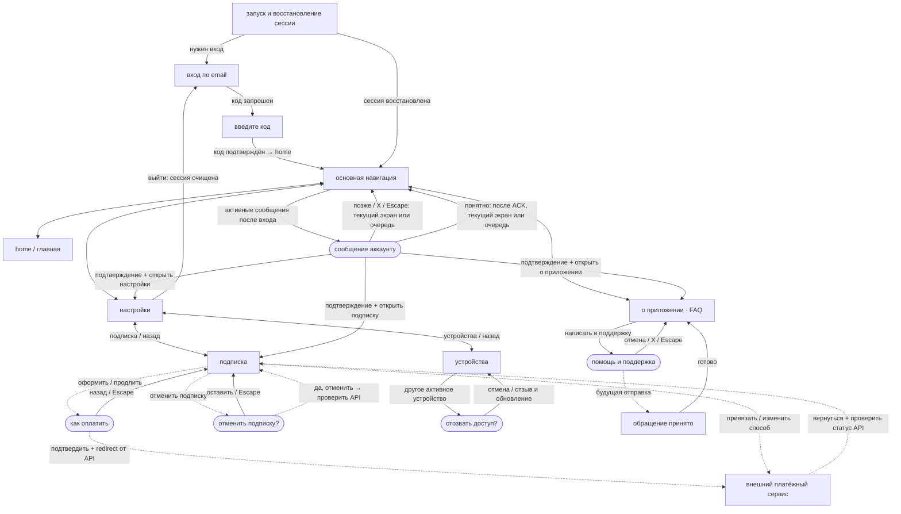
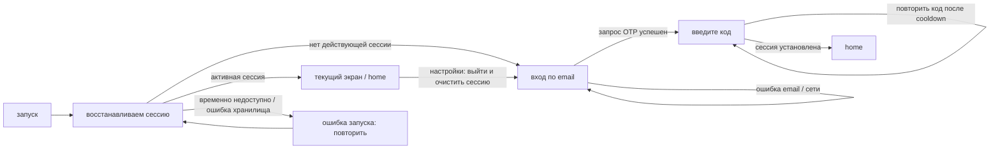
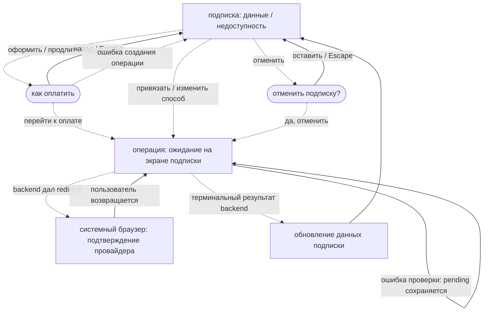

# Relay and daily balance — Windows 0.16.0 / Android 0.13.0

Home Connect attempts direct WireGuard, then WireGuard through permanent RU,
then the remaining placeholders. Both implemented adapters use the existing
permission/UAC, verification, cancellation and confirmed-cleanup flows. Progress
names the current method and previous failure; the connected method remains visible.
Free Home displays the account-wide daily remainder, including unused active
reservations, and next UTC reset. Unknown balance displays a dash; paid plans
hide the counter. Profile refreshes on Home entry/state changes and every 30s.
No new routes or external transitions. Other protocols remain placeholders.
See [backend integration and rollback](wireguard-relay-quota.md).

# WireGuard connection — Windows 0.15.0 / Android 0.12.0

Home Connect now attempts real WireGuard before the remaining placeholders.
Windows may show a UAC prompt for the official WireGuard tunnel service; if the
official client is missing or another VPN is active, Home displays a short reason.
Android shows the system VPN permission prompt and requires no second APK.
The existing progress text remains visible during provisioning and verification.
Connected and protocol details require a successful tunnel-bound Internet check.
Cancel/Disconnect completes local and server cleanup; Settings Logout now stops
the VPN before revoking authentication. Existing routes, auth guards, subscription,
support and payment navigation are unchanged. Native screenshot/build/live evidence
belongs in PR #32; implementation alone does not establish acceptance. See
[client handoff](client-wireguard.md).

## Current location and backend label — Windows 0.14.1 / Android 0.11.1

Home current location uses the actual public egress with a bounded HTTPS fallback
if the primary provider fails. Android refresh is independent of account metadata.
Windows Backend label displays only the validated SemVer core from GET /version,
matching Android; invalid/unavailable responses display unavailable. UI routes,
auth guards and the 14 VPN placeholders remain unchanged. See
[location/version handoff](client-location-fix.md) for evidence and limitations.

## VPN reset — Windows 0.14.0

Home Connect now starts the shipped 14-method placeholder executor. Each method
waits 3 seconds and fails; the status names the current and previous method.
The button changes to Cancel during the sequence and immediately cancels the timer.
All failures leave Home disconnected with an explicit placeholder message.
Country metadata still loads from `/vpn/countries`; unavailable countries may be
selected for placeholder tests. No session/credential API call or system VPN prompt
occurs. Account change/logout cancels the executor. Other routes and external
payment/support/auth flows retain their existing contracts.

Future adapters plug into the same executor and must return verified success;
only then will the existing connection details appear. That integration is pending.
See [handoff](vpn-placeholder-reset.md).

# Windows: экраны, окна и переходы

Android 0.10.0: Home → внутренняя ConsentActivity → системное VPN-разрешение →
Home с перебором WireGuard и managed-плана. Внешнего перехода ко второму APK
больше нет. Комментарий попытки остаётся видимым и во время проверки; после
успеха показывается выигравший протокол/транспорт. Серверный контракт реализован,
фактическая выкладка и приёмка отмечаются в [плане](android-single-apk-plan.md).
Windows в этой задаче unchanged 0.13.0; подключение новых движков ещё ожидается.

Windows 0.13.0 / Android 0.9.0: Home показывает короткий комментарий текущей
попытки («Пробую WireGuard…», «WireGuard не подключился, пробую OpenVPN…»).
Переход к следующему способу публикуется только после подтверждённой остановки
предыдущего. При проверке интернета комментарий сменяется статусом проверки;
после успеха отображается фактический способ. Отмена/ошибка очищает комментарий.
Это отображение реально выданных кандидатов, а не обещание наличия нового движка.
Подробности профиля и тексты технических исключений в комментарий не попадают.

Android 0.5.0: Home/Settings/About → devices/messages/subscription/support, nested Back,
revoke/logout confirmation, ACK → internal navigation только после receipt; поддержка
имеет discard draft/status/retry исходного UUID. Auth guard очищает account stack.
Платёжные действия при DISABLED/SANDBOX недоступны. Windows не менялся.
См. [Android account API](android-account-api.md).

Android 0.4.0: обычный запуск использует OTP → проверка кода → /me account shell;
Back из OTP возвращает email, успешный вход/restore убирает auth UI. Revoke/expiry
переводят в sign-in; offline restore предлагает retry/явное удаление local credentials.
Logout confirmation закрывается только после серверного результата. Fixture-переходы
изолированы в instrumentation. Windows не менялся. См. [Android auth/session](android-auth-session.md).

> Android 0.3.0/code3: [экраны на изолированных fixtures](android-fixture-screens.md).
> Windows0.12.0/backend0.10.0/schema0026 unchanged. Debug-only, no real VPN/API;
> English base, шесть языков отдельно. Историческое описание 0.2.0 ниже сохранено.
> Source/build SHA, все CI runs и native evidence — в task PR.

Карта Windows **0.11.1** с контрактами backend **0.10.0**.
Маршруты Windows сохранены с merge PR #5; устройства реализованы в backend 0.2.0,
общие сообщения аккаунту — в backend 0.3.0; поддержка — в backend 0.4.0. Фактический rollout зафиксирован в PR.
Это карта фактического UI и подготовленных условных сценариев, не подтверждение
работы реальных платежей, почтовой отправки или синхронизации сообщений.
Документация не меняет версии приложения.

Home обновляет `/me` при каждом открытии и смене access token. До ответа виден
сохранённый профиль; свежий ответ обновляет тариф и счётчик устройств. Ошибка
запроса показывает штатное сообщение с повтором. См. отдельную приёмку
[Windows с development](windows-development-acceptance.md): loopback UI review
и прямой HTTPS-прогон подтверждают разные интеграции.

Длинная runtime-версия backend ограничена шириной боковой панели и сокращается
многоточием; полное значение доступно в tooltip и About. Native acceptance
проверяет границы блока версии с реальной development-строкой.
Публичная локация по умолчанию загружается отдельной native-командой к ipwho.is:
бесплатный сервис отклоняет автоматический Origin общего HTTP-плагина. Явные
test/preview endpoints продолжают использовать прежний transport; fallback/retry
при недоступности сервиса сохраняется.

## Возможности оплаты — Windows 0.11.0

Экран подписки читает `provider_mode` и четыре `payment_routes` из overview.
Платёжные действия доступны только при LIVE, явном operations_available, account
action и подходящей валюте. Текущий backend не подключает реального провайдера и
не выдаёт LIVE. DISABLED/SANDBOX и старый ответ backend оставляют UI read-only.
Просмотр цен/срока и чтение pending-операции сохраняются; внешний переход без LIVE
не выполняется. Положительные LIVE-сценарии native review — только loopback fixtures.

Dialog показывает четыре маршрута с прежними иконками. Неподдерживаемая валюта
отключает строку; доступны подписи автопродления/разовой оплаты. Без подходящего
варианта подтверждение выключено. Валюта продления ограничена договором. Смена
revision скрывает устаревший dialog; отправка повторно проверяет актуальную
матрицу. Backend независимо проверяет эти условия до provider IO.

API-тесты sandbox проверяют валюты и mandate state; SANDBOX не разрешает
коммерческие действия Windows. Проверенные source SHA/run/attempt, скриншоты и
native executable фиксируются в task PR.

## Сводная схема

Прямоугольники — экраны/логические состояния. Скруглённые узлы — popup поверх
текущего экрана; это HTML dialog/alertdialog в одном native окне Tauri, не новые
окна операционной системы. Браузер платёжного сервиса — отдельное приложение.
«Основная навигация» — логический узел для трёх иконок, не отдельный экран.
Сплошные стрелки — реализованные локальные переходы. Пунктир — сценарий требует
ещё не подключённого backend API, sender или платёжного провайдера.

«Понятно» требует ACK от backend; «позже»/X/Escape его не отправляют. Возврат
из сообщения означает тот же подлежащий экран, а не обязательный переход home.
Если есть следующее сообщение, открывается оно. Для оплаты схема выше сокращена:
между подтверждением, браузером и результатом есть состояние операции на экране
подписки, подробно ниже. Возврат из браузера не подтверждает оплату.

## Экраны и маршруты

HashRouter хранит маршруты после `#`. Здесь приведены пути React Router без `#`.

| Экран | Маршрут | Как попасть и выйти |
| --- | --- | --- |
| Проверка сохранённой сессии | До отображения маршрута | При запуске; затем текущий допустимый маршрут или вход. Ошибка восстановления → «повторить». |
| Вход по email | `/login` | Нет активной сессии или успешный выход. Запрос кода → OTP. |
| Введите код | `/auth/verify-otp` | После успешного запроса OTP с email в route state. Успешный вход → `/`. Ошибка/повтор кода остаются здесь. |
| Home / главная | `/` | После нового входа, по иконке дома или глобальному fallback. VPN, список стран и параметры — состояния этого экрана. |
| Настройки | `/settings` | Иконка шестерёнки или «← настройки» из вложенного экрана. Здесь подписка, устройства и выход. |
| Подписка | `/settings/subscription` | Пункт настроек или действие сообщения. Назад → настройки; боковые иконки доступны. |
| Устройства | `/settings/devices` | Пункт настроек. Назад → настройки; отзыв другого устройства открывает подтверждение. |
| О приложении | `/about` | Иконка информации или действие сообщения. Версии, пустой FAQ и вход в поддержку находятся на одном экране. |

Боковые иконки переключают Home/Settings/About из любого основного экрана,
включая вложенные настройки. На email/OTP они отображаются неактивными.
Заголовок PrettyLisaVPN в верхней панели не является кнопкой перехода.

Совместимость маршрутов и ограничения текущего UI:

- Старый `/devices` перенаправляет в `/settings/devices`.
- Неизвестный глобальный маршрут ведёт в `/`, затем действует проверка сессии.
  Неизвестный вложенный `/settings/*` попадает в Settings: отдельного fallback
  внутри вложенных Routes сейчас нет, поэтому такой путь может дать пустую область.
- Прямой OTP без email в route state при отсутствии авторизации ведёт на вход.
  Отдельной кнопки «изменить email» на OTP сейчас нет.
- При восстановленной авторизации допустимый текущий маршрут сохраняется.
  Если он `/login` или `/auth/verify-otp`, gate переводит в `/`. После нового OTP
  всегда открывается `/`, сохранённого return-to маршрута нет.
- «Вход выполнен» есть как внутреннее состояние OtpForm, но в основном приложении
  SessionRestorationGate перенаправляет авторизованного пользователя home.
  Это не самостоятельный экран навигации.
- FAQ, список стран, параметры подключения и состояние «обращение принято»
  не имеют отдельных маршрутов.

## Запуск, ошибки и выход

При временной ошибке восстановления сессия сохраняется, доступны повторные
попытки. Ошибка конфигурации при создании приложения показывает отдельное
«не удалось запустить PrettyLisaVPN» до основного UI: исправить конфигурацию
и перезапустить. Это не ошибка OTP и не переход в настройки.

«Выйти» вызывает API logout и очищает сессию/защищённые credentials. При отказе
авторизации также пытается очистить её; обычная сетевая ошибка остаётся на
настройках с сообщением. Успешная очистка приводит ко входу через gate.
Сброс сессии из Home/Devices/Subscription также возвращает на вход. Ошибка
необязательного messages API сама по себе пользователя не разлогинивает.

Кнопка Windows «Свернуть» не является выходом из аккаунта. «Закрыть» закрывает
native окно; в её обработчике нет API logout или очистки сохранённой авторизации.
При следующем запуске снова выполняется восстановление. Ошибка оконной команды
показывается баннером, без отдельного маршрута.

## Popup-окна

| Окно | Откуда / условие | Закрытие и результат |
| --- | --- | --- |
| Сообщение аккаунту | После нового входа или восстановления, поверх текущего основного экрана; только если API вернул сообщения | «Понятно» ждёт ACK; основная кнопка затем открывает Subscription/Settings/About. «Позже», X, Escape не ACK. Далее следующее сообщение или тот же экран. Ошибка ACK оставляет окно и повтор. |
| Как оплатить | Subscription → оформить/продлить, если backend разрешил действие и прислал предложение | Radio ничего не отправляет. Назад/Escape → тот же экран без операции. «Перейти к оплате» закрывает popup, создаёт операцию и при redirect открывает браузер. |
| Отменить подписку? | Subscription → отменить, если действие доступно | «Оставить подписку»/Escape → тот же экран. «Да, отменить» закрывает popup и запускает backend-операцию; права/срок меняются только после ответа backend. |
| Отозвать доступ? | Devices → другое ACTIVE-устройство | «Отмена» → список. «Да, отозвать» → API, затем обновление списка и уведомление; ошибка оставляет подтверждение. У текущего устройства этой кнопки нет. |
| Помощь и поддержка | About → написать в поддержку | X/Escape/отмена → About, черновик и вложения удаляются. При подключённом sender успешный receipt показывает «обращение принято» в том же popup; «готово» закрывает его. HTTP sender подключён: backend подтверждает приём; «проверить статус» обновляет состояние письма. |

Для отзыва устройства используется `div role=alertdialog`, а не HTML dialog:
в коде есть только «отмена», отдельного X или обработчика Escape нет. Не переносить
автоматически поведение Escape других окон на этот сценарий.

Сообщения аккаунту ждут закрытия другого modal-окна. Смена аккаунта/сессии
удаляет их очередь и отменяет запросы; истечение срока убирает сообщение без ACK.
Закрытие поддержки во время отправки отменяет ожидание клиента, но не
доказывает отмену уже принятого сервером обращения.

## Подписка и внешний браузер

GET /billing/overview подключён к PostgreSQL-каталогу с группами и периодами.
При payment_operations_available=false/actions=[] экран показывает серверные цены
и данные договора, отключает оплату/продление и скрывает изменение способа/отмену.
Ручной Platinum не продаётся. Старая локальная операция очищается без polling.
Показанный payment flow остаётся подготовкой для будущего провайдера; POST/GET
операций реализованы в backend 0.7.0, но без adapter новые запросы получают
503 BILLING_DISABLED. Сохранённый pending восстанавливается через overview/GET
независимо от устройства; настоящие списания выключены. Детали: [subscriptions-ui.md](subscriptions-ui.md).
Без данных backend Subscription показывает недоступность без выдуманных цен.
Free/Expired предлагают оформление, Active/Canceled с оплаченным сроком — продление;
кнопки дополнительно зависят от серверного actions. При отменённом автопродлении
оплаченный доступ должен сохраняться до paid_until — это обязательство будущего backend.

В «как оплатить» четыре выбора: МИР, банковская карта, Alipay/WeChat Pay, криптовалюта.
RUB предвыбирает МИР, USD — банковскую карту. Привязка/изменение существующего
способа оплаты идут напрямую через операцию, без этого селектора.

Операция не обязана содержать redirect. Если он есть, приложение открывает только
разрешённый HTTPS URL через системный браузер; штатная allowlist пока пустая.
При pending можно повторно открыть тот же redirect. Возврат вручную/focus/«обновить»
проверяет статус операции: ни возврат, ни URL браузера сами по себе не успех.
Опрашивание pending ограничено по времени и возобновляется при focus/обновлении.
Deep link автоматического возврата сейчас не внедрён.

## Что остаётся внутри экранов

| Область | Локальные состояния, не новые окна/маршруты |
| --- | --- |
| Home | Загрузка/ошибка профиля и повтор, список стран, статусы подключения, раскрытие публичных параметров, обновление текущей локации. |
| VPN на Home | Connecting → Tunnel established → Verifying internet → Connected; также Reconciling/Disconnecting/Degraded/Failed/Unavailable. Подробная машина состояний — отдельный документ. |
| Режим трафика | Весь трафик работает в текущем flow; два выборочных режима пока отключены и не ведут на другие экраны. |
| Devices | Загрузка, ошибка/повтор, пустой список, активные/отозванные карточки. «Последний вход» берётся из `last_login_at` backend 0.2.0; до первого успешного OTP-входа старое устройство показывает «нет данных». |
| Subscription | Загрузка/недоступность, Free/Active/Canceled/Expired, выбор валюты/предложения, pending/notice/error. |
| About | Две версии, пустой FAQ и подпись Lisa. Версия backend недоступна → текст «недоступна», навигация остаётся доступной. |
| Поддержка | Поля, выбор/удаление файлов, checkbox и раскрытие диагностики. Отправка сейчас отключена; «принято» существует как будущий результат sender. |

## Источники и актуализация

Проверены фактические маршруты/guard/обработчики в исходниках 0.9.0:

- [App](../apps/windows/src/ui/App.tsx), [SessionRestorationGate](../apps/windows/src/ui/SessionRestorationGate.tsx), [WindowFrame](../apps/windows/src/ui/WindowFrame.tsx).
- [Login](../apps/windows/src/ui/Login.tsx), [OtpVerification](../apps/windows/src/ui/OtpVerification.tsx), [Home](../apps/windows/src/ui/Home.tsx).
- [Settings](../apps/windows/src/ui/Settings.tsx), [Devices](../apps/windows/src/ui/Devices.tsx), [Subscription](../apps/windows/src/ui/Subscription.tsx), [PaymentChoice](../apps/windows/src/ui/PaymentChoice.tsx).
- [About](../apps/windows/src/ui/About.tsx), [SupportDialog](../apps/windows/src/ui/SupportDialog.tsx), [AccountMessages](../apps/windows/src/ui/AccountMessages.tsx).

Связанные спецификации: [Home](home-screen.md), [проверка VPN](connection-verification.md),
[подписки](subscriptions-ui.md), [устройства](devices-ui.md), [поддержка](support-ui.md),
[сообщения аккаунту](account-messages.md).

При добавлении/изменении маршрута, popup, возврата, auth guard или внешнего
перехода обновлять эту карту вместе с изменением UI. Проверять прямой вход
по маршруту, отсутствие авторизации, назад/отмену, ошибку API, смену аккаунта
и действительное наличие backend. Новые экраны Android/iOS описывать отдельными
картами: этот документ не выдаёт Windows flow за готовую реализацию других платформ.

Проверенная продуктовая сборка перед merge: HEAD
`be4cfc28e7372c7736028273d96146713392e838`, PR build
`27db70bc0a151a26c361bb5c4b672f0867db6905`,
[Windows UI review 39022996113](https://github.com/romankenig/PrettyLisaVPN/actions/runs/39022996113),
attempt 1, success, 299 тестов и native screenshots. Данный docs-only commit
не является новой сборкой приложения и не подтверждает реальный VPN/платёж/почту.

После merge PR #8 backend 0.2.0 развёрнут на development; `last_login_at` и
отзыв auth/VPN-сессий реализованы, см. [контракт устройств](devices-ui.md).
Маршруты, popup и версия Windows этой backend-задачей не изменены.
[Device backend review 39086058944](https://github.com/romankenig/PrettyLisaVPN/actions/runs/39086058944)
завершился success: 299 Windows tests и native capture с записанными ответами
backend из изолированной CI PostgreSQL. Авторизация UI и node agent там
симулируются; это не live-проверка VPN-трафика или платежей.
Фактические deploy/version/readiness и миграция 0018 зафиксированы в
[PR #8](https://github.com/romankenig/PrettyLisaVPN/pull/8).

Backend 0.3.0 реализует общий JSON v1 messages API и account-wide ACK,
см. [сообщения аккаунту](account-messages.md). Стрелки сообщений теперь опираются
на реализованный backend-контракт; публикация служебной CLI определяет наличие
контента. После ACK на Windows следующий запрос другого устройства того же
аккаунта не возвращает эту редакцию. Android/iOS и другие приложения получают
этот flow после подключения контракта в своих клиентах; их UI здесь не описан.

Поддержка Windows 0.9.0: стабильный UUID при повторе открытой формы, GET статуса
перед повторным POST; закрытие не отменяет серверный приём. SMTP — только на
backend 0.4.0. Гарантии и ограничения: [support-ui.md](support-ui.md).

## Язык интерфейса — Windows 0.12.0

Внизу sidebar, включая login/OTP, добавлен раскрывающийся выбор шести языков.
Смена языка не меняет маршрут, не очищает формы, не выполняет logout и не создаёт
VPN/billing operations. Ручная настройка сохраняется; язык интерфейса и версия ОС
независимы. Клавиатура, выбор флага/English/native names и безопасная автонастройка
до VPN описаны в [windows-localization.md](windows-localization.md).

## Сопоставление с Android 0.2.0

Windows 0.12.0 остаётся без изменений; его палитра, логотип, Rubik и состояния
компонентов перенесены в мобильную UI-основу Android. Три вкладки, вертикальные
карточки и отдельный экран локальной формы заменяют sidebar/desktop popup.
Это не добавляет Windows routes/API и не подтверждает Android auth/VPN интеграцию.
См. [Android design](android-design.md) и [архитектуру](android-architecture.md).

Android 0.6.0 переносит выбор шести языков в правый верхний угол общей мобильной
шапки; auth/OTP и экраны аккаунта используют одну шапку с логотипом и версиями.
Смена языка не создаёт новый маршрут и не повторяет HTTP-операции. Resend/change
email — текстовые действия над подтверждением OTP. Windows-маршруты и backend
не меняются; детали: [android-language-ui.md](android-language-ui.md).

Android 0.6.1 уточняет общую шапку: увеличенный бренд, выровненный двуязычный
selector, компактная фактическая backend SemVer и строчные локализованные подписи.
При крупном шрифте selector справа сверху занимает отдельную строку. Маршруты,
API и Windows unchanged; приёмка: [android-language-ui.md](android-language-ui.md).

Android 0.6.2 переносит версии в общий footer под мобильной навигацией/экранами.
Полоска остаётся над клавиатурой и учитывает системные отступы; флаг сближен с
названиями языка. Маршруты, Windows и backend unchanged; детали и приёмка:
[android-language-ui.md](android-language-ui.md).

Android 0.6.3 приводит About к Windows 0.12.0: версии, пустой FAQ, помощь/обращение
в поддержку, посвящение. На телефоне карточки вертикальные, поддержка открывается
существующим экраном SUPPORT с прежним Back/draft guard. Fixture-only messages и
Scenarios перенесены из About в Settings; обычный live Home сохраняет Messages.
OTP resend/change email сгруппированы в FlowRow перед sign in, с переносом при
нехватке ширины. Windows/backend не меняются; см. [android-about-otp-ui.md](android-about-otp-ui.md).

Android 0.6.4 уменьшает только отступы OTP-ссылок (80dp → 56dp вместе с touch row)
и исправляет симметрию Android знака. Ссылки используют Rubik Medium/Christalle;
переходы, cooldown, Back guard, Windows и backend unchanged. См.
[android-otp-icon-polish.md](android-otp-icon-polish.md).

Android 0.7.0 сверяет главную/настройки с текущим Windows: сводка аккаунта,
автопилот/страна, текущая сеть и режимы защиты. Служебные кнопки убраны с Home:
Messages перенесены в Settings, Support по-прежнему из About. Connect — только
UI preview без backend VPN mutation. Устройства используют edge-pull refresh;
Settings содержит иконки и красный logout. Support сохраняет Back/draft guard,
показывает подготовку/имена/крестик вложений и одну отправку без Done; диагностический
техблок opt-in. Windows routes/backend unchanged; см.
[android-home-support-polish.md](android-home-support-polish.md).

### Android 0.7.1: локации, устройства и связь

Home использует один dropdown автопилот → топ-3 → все доступные страны с флагами
и фактическим quality из GET /vpn/countries. Текущие регион/IP находятся внутри
карточки подключения. Connect остаётся активным UI preview без VPN/session POST.
Devices показывает только ACTIVE, текущее устройство первым с яркой отметкой;
отзыв текущего устройства по-прежнему завершает сессию. Settings → уведомления
сервиса сохраняет серверные ACK revision/navigation guards и отличается от поддержки.
Общая полоса потери связи доступна на всех live-маршрутах, включая auth, над footer.
При возвращении default network с INTERNET capability проверяется public GET /version;
OS VALIDATED не требуется (проверка Android может быть заблокирована при доступном API);
при остановке Activity callback/опрос освобождаются. Windows/backend не изменены.
См. [Android handoff](android-location-connectivity-polish.md).

### Android 0.7.2: OTP и служебные popup

Settings больше не содержит уведомлений; маршрут MESSAGES удалён из live UI.
После авторизации Android получает GET /messages и показывает очередь по одному
popup, подобно Windows AccountMessages. Данные очереди/отсрочки только в памяти
текущего входа, истории/архива нет. «Позже»/Back закрывает без ACK; подтверждение
или целевое действие отправляет ACK UUID/revision, переход — после успеха.
Ошибка оставляет popup с retry; expiry скрывает сообщение и блокирует запоздалый
переход; существующие подтверждения logout/revoke/payment/discard имеют приоритет.
После перезапуска неподтверждённое сообщение может прийти снова, как в Windows.
Пауза resend OTP — 60 секунд; текущая установка отмечена Heliotrope/Christalle.
Backend/Windows не изменены; UI connect остаётся preview. См.
[handoff](android-otp-popup-polish.md).

### Android 0.8.0: настоящий VPN lifecycle

Home connect теперь запускает системный VPN consent, затем отдельное notification
permission и production WireGuard VpnService. Отказ не создаёт backend session.
Кнопка становится disconnect в connecting/verifying/connected; после сбоя доступны
ошибка и повтор cleanup. Connected только после VPN-bound проверки, не по UP.
Logout сначала прекращает VPN и очищает backend session; неподтверждённый cleanup
сохраняет credentials для повтора. При current-device revoke local stop обязателен,
затем подтверждённый RPC передаёт durable termination серверу и завершает вход. Back/tab/rotation не
повторяют POST и не владеют lifetime туннеля; stop есть в постоянном уведомлении.
Отдельные fixture-маршруты по-прежнему явно симулированы, release их не содержит.
Windows navigation/backend unchanged; [handoff](android-vpn-runtime.md).
